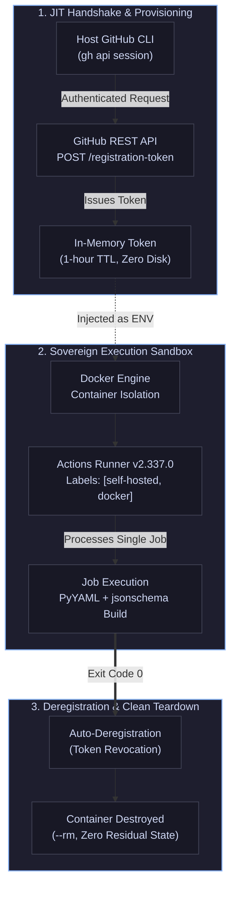

# gem-studio-runner 🏃‍♂️🐳

[](LICENSE)
[](https://www.docker.com/)
[](https://github.com/actions/runner)
[](https://releases.ubuntu.com/24.04/)

> Containerized, strictly ephemeral (`--ephemeral`) GitHub Actions runner infrastructure dedicated to executing sovereign CI/CD workloads for [rmasabela/gem-studio](https://github.com/rmasabela/gem-studio) with zero billable cloud minutes and zero persistent state contamination.

---

## 📖 Overview

**gem-studio-runner** provides the decoupled execution infrastructure for the [gem-studio](https://github.com/rmasabela/gem-studio) Prompt-as-Code platform. Private GitHub repositories consume billable Actions minutes for every CI build, contract verification, and catalog deployment. Furthermore, persistent self-hosted runners accumulate orphaned dependencies and transient files, introducing environment drift and security risks.

This repository resolves both challenges through a sovereign, single-use containerized architecture:

1. **Strict Process Isolation (`--ephemeral`)**: Every runner instance boots inside a sealed Ubuntu 24.04 container, services exactly one job from the queue, immediately purges its credentials, and terminates cleanly (`--rm`).
2. **Volatile In-Memory Security Handshake**: Registration tokens are generated just-in-time via the authenticated host GitHub CLI (`gh api`) with a 1-hour TTL and passed strictly via memory into container environment variables, avoiding secrets at rest.
3. **Symmetric Cross-Platform Bootstrap**: Identical operational interfaces across heterogeneous workstations via native orchestrators: POSIX Bash (`launch.sh`) for macOS/Linux and PowerShell Core (`launch.ps1`) for Windows/WSL2.

---

## 🏗️ Repository Architecture

```text
gem-studio-runner/
├── Dockerfile          # Sovereign Ubuntu 24.04 container recipe & runner v2.337.0 toolchain
├── entrypoint.sh       # In-container lifecycle: dynamic handshake, --ephemeral registration, & teardown
├── launch.sh           # Host orchestrator for macOS / Linux (NEWTON-SPARK / WSL2)
├── launch.ps1          # Host orchestrator for Windows PowerShell (TITAN-SHIFT)
├── LICENSE             # MIT License
└── README.md           # Technical architecture and operational runbook

```

---

## ⚙️ Core Architecture & Operational Runtime

### 1. The Ephemeral Lifecycle Loop

The runner guarantees zero residual state by enforcing GitHub Actions' native `--ephemeral` flag alongside Docker's `--rm` lifecycle:



### 2. Base Container Specifications (`Dockerfile`)

* **Base Operating System**: Ubuntu 24.04 LTS (`noble`) for `linux/amd64`.
* **Runner Binary**: Official GitHub Actions Runner `v2.337.0`.
* **System Toolchain**: `curl`, `ca-certificates`, `git`, `jq`, `sudo`, `lsb-release`, `build-essential`, `libicu-dev`.
* **Python Ecosystem**: Native Python 3, `python3-pip`, `python3-venv`, with pre-installed `pyyaml` and `jsonschema` for contract validation.
* **Security Context**: Executes under an unprivileged `runner` system user with passwordless `sudo` rights restricted to execution requirements.

---

## 🚀 Workstation Orchestration & Launch

### Prerequisites

* **Docker**: Docker Desktop or Docker Engine active and responding to the host daemon socket.
* **GitHub CLI (`gh`)**: Authenticated with administration permissions (`repo` / `actions:write`) over `rmasabela/gem-studio`.

```bash
# Verify Docker daemon connectivity
docker info

# Verify GitHub CLI authentication
gh auth status

```

### Execution Runbook

#### A. macOS & Linux Workstations (`NEWTON-SPARK` / WSL2)

Execute the POSIX launcher from the repository root:

```bash
./launch.sh

```

#### B. Windows Workstations (`TITAN-SHIFT`)

Execute the PowerShell orchestrator:

```powershell
.\launch.ps1

```

Both launch scripts execute an identical three-stage bootstrap sequence:

1. `[1/3]` Queries `gh api` for a dynamic 1-hour registration token.
2. `[2/3]` Verifies the local Docker cache and builds `gem-studio-runner:latest` if absent.
3. `[3/3]` Spawns the container interactively, registering with labels `[self-hosted, docker, gem-studio, <host-node>]`.

---

## 🔗 Decoupled Integration with `gem-studio`

Workflows in the parent repository route to this infrastructure using declarative label constraints in `.github/workflows/ci.yml` and `deploy.yml`:

```yaml
jobs:
  validate-and-build:
    name: Validate Schema & Build Manifests
    runs-on: [self-hosted, docker, gem-studio]
    steps:
      - name: Checkout repository
        uses: actions/checkout@v4
      - name: Validate and build all active Gems
        run: python scripts/build-gem.py gems/vault-distiller

```

When a commit lands on `main`, jobs enter a `Queued` state until an on-demand runner container is launched on a physical workstation, completing the build locally and exiting cleanly.

---

## 📄 License

This project is open-source software licensed under the terms of the [MIT License](https://www.google.com/search?q=LICENSE).

**Author**: [Ricardo Masabel](https://github.com/rmasabela)

**Parent Platform**: [rmasabela/gem-studio](https://github.com/rmasabela/gem-studio)
